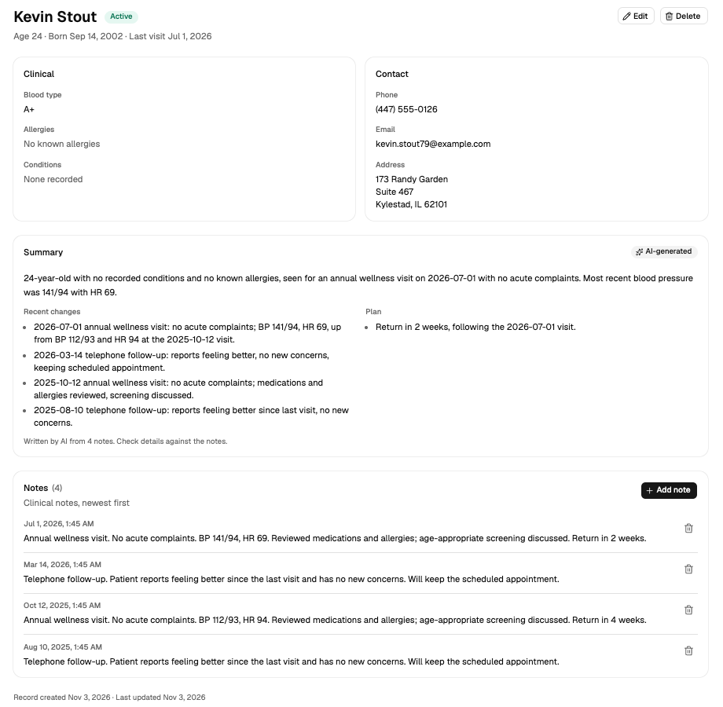

# Healthcare Patient Dashboard

[](https://github.com/palmer95/ascertain_dashboard/actions/workflows/ci.yml)

A patient-management dashboard for a medical practice: a paginated, searchable patient list
with advanced filters, patient records with clinical notes, and an AI-written summary of each
patient's notes.

**Stack:** React 19 + TypeScript (Vite) · FastAPI (async SQLAlchemy, Alembic) · PostgreSQL 18 ·
Docker Compose



## Quick start

Needs Docker only.

```sh
git clone https://github.com/palmer95/ascertain_dashboard.git
cd ascertain_dashboard
docker compose up --build
```

| What               | URL                        |
| ------------------ | -------------------------- |
| App                | http://localhost:8080      |
| API docs (Swagger) | http://localhost:8000/docs |
| PostgreSQL         | `localhost:5433`           |

On first start the backend runs the database migrations and seeds 150 synthetic patients with
about 360 clinical notes. Both steps are idempotent: restarting doesn't duplicate anything.
`docker compose down -v` resets the data.

**`.env` is optional.** Every setting has a working default. To change ports or turn on AI
summaries, `cp .env.example .env` and edit it.

**AI summaries (optional):** set `ANTHROPIC_API_KEY` in `.env` and restart. Without a key the
summary is built from a template, so the app works with no configuration (see
[Patient summary](#patient-summary)).

## Local development

Needs Python 3.14 with [uv](https://docs.astral.sh/uv/), Node 24+ with pnpm, and Docker for
the database.

```sh
docker compose up -d db                 # PostgreSQL on localhost:5433

# Terminal 1: the API
cd backend
uv sync
uv run alembic upgrade head && uv run python -m app.seed
uv run fastapi dev                      # http://localhost:8000

# Terminal 2: the app
cd frontend
pnpm install
pnpm dev                                # http://localhost:5173, /api proxied to :8000
```

After changing the API, run `pnpm gen:api` in `frontend/` to regenerate the typed client.
CI fails if it's out of date.

## Tests and checks

| Suite           | Command (directory)           | What it covers                                                                                                       |
| --------------- | ----------------------------- | -------------------------------------------------------------------------------------------------------------------- |
| API (78)        | `uv run pytest` (`backend/`)  | Every endpoint, validation, errors, filters, summary fallback, against a real Postgres test DB                       |
| Components (28) | `pnpm test` (`frontend/`)     | Patient form, notes, tag input, list search and filters, with the API mocked by MSW                                  |
| End-to-end (5)  | `pnpm test:e2e` (`frontend/`) | Main journeys in a real browser: create → note → summary → edit → delete, search and filters, dashboard, theme, 404s |

Lint, formatting and strict types: `uv run ruff check . && uv run ruff format --check . && uv run mypy .`
in `backend/`, and `pnpm lint && pnpm format:check && pnpm typecheck` in `frontend/`.

- **API tests** create and drop their own `ascertain_test` database (the database container
  must be running) and roll back each test. The AI model is never called; a fake client stands
  in for it.
- **End-to-end tests** need the API running and start the Vite dev server if it isn't up. To
  test the Compose stack instead: `E2E_BASE_URL=http://localhost:8080 pnpm test:e2e`. Each test
  creates its own uniquely named patients and deletes them afterwards.
- **CI** ([`.github/workflows/ci.yml`](.github/workflows/ci.yml)) runs all of the above on
  every push and pull request. The end-to-end job uses the same `docker compose up` as above.

## Architecture

```
browser ──► nginx :8080 ──┬── static React build
                          └── /api/* ──► FastAPI :8000 ──► PostgreSQL
                                              └── (optional) Anthropic API, for summary narratives
```

nginx serves the built app and forwards `/api/*` to the backend, stripping the prefix; in
development the Vite proxy does the same. The browser only talks to its own origin, so there is
no CORS setup and no API URL baked into the build.

```
backend/app/
  routers/    HTTP layer: thin, validates input, maps to status codes
  services/   business logic and queries (patients, notes, summary, dashboard)
  models/     SQLAlchemy tables · schemas/  Pydantic request/response models
  core/       config, database, error handlers, logging middleware
backend/alembic/   migrations · backend/tests/   API tests
frontend/src/
  features/   patients, notes, summary, dashboard: each with its components and queries
  components/ shared UI (shadcn/ui) · api/  generated, typed API client · pages/  routes
```

## Key decisions and trade-offs

**Data and API**

- **Search, filtering, sorting and pagination all run on the server.** Searching only the page
  already loaded would miss patients. Name search uses a trigram index, so `ILIKE '%smi%'` stays
  fast as the table grows. Pagination is offset-based (`{items, total, limit, offset}`, 20 per
  page, max 100): simple and right for a page-numbered table. Keyset pagination would replace it
  at much larger scale.
- **One error shape everywhere:** `{"error": {"code", "message", "details": [{"field", "msg"}]}}`.
  The frontend maps 422 `details` straight onto form fields, so server-side validation errors
  appear next to the right input. Unknown request fields are rejected rather than silently
  ignored, and 500s never leak internals.
- **`PUT` is a full replacement**, as the brief specifies. Concurrent edits are
  **last-write-wins**; production would reject stale writes with an `If-Match`/`updated_at`
  check.
- **Delete is a hard delete** that cascades to notes, as the brief asks. A real practice would
  soft-delete for audit and record-retention rules.
- **Modelling choices:** email is _not_ unique (families often share one); `status` is
  administrative (active / inactive / pending / discharged), kept separate from clinical acuity;
  age is computed from date of birth, never stored; allergies and conditions are text arrays.
  Coded terminologies (SNOMED CT, ICD-10, RxNorm) would be the next step. IDs are UUIDv7:
  not guessable, and they index well.
- **A note is a visit.** Each note records an encounter (a visit or a call), so a patient's last
  visit is the time of their latest note. It's stored on the patient, so the list can sort and
  filter by it with an index, and updated in the same transaction as every note added or
  deleted.
- **Dates of birth stay plain dates end to end.** Parsing `"1990-05-01"` as a JavaScript `Date`
  treats it as UTC midnight, which shows US users the day before.
- **Schema changes go through Alembic**, run by the container on startup. The seed is
  deterministic (fixed Faker seed) and idempotent.

**Frontend**

- **Server state lives in TanStack Query; list state lives in the URL.** Search, filters, sort and
  page are query parameters, so a filtered list can be shared, survives a refresh and works with
  the back button. There's no global store because nothing needs one.
- **Search stays responsive:** typing is debounced (300 ms) and the previous results stay on
  screen while the next page loads, so the table never flashes empty.
- **The API client is generated from FastAPI's OpenAPI schema** (`openapi-typescript` +
  `openapi-fetch`), so the frontend and backend share one contract and type errors show up at
  compile time. CI regenerates it and fails on any difference.
- **Forms** use React Hook Form + Zod, with rules that mirror the backend's. Failed saves keep
  the entered data and offer a retry, and leaving with unsaved changes asks first.
- **UI** is shadcn/ui on Base UI with Tailwind: accessible primitives, with the component code in
  the repo to adapt. Routes are lazy-loaded, so the chart library loads only on the dashboard.
  The layout is responsive down to phone width: the sidebar becomes a drawer and the table
  becomes cards.
- TypeScript is pinned to 6.0 because typescript-eslint doesn't support TypeScript 7 yet.

**Growing the app.** The brief expects multiple user types, complex workflows and real-time
features. Routes are thin, so authentication and roles can become a FastAPI dependency without
touching business logic. New areas get their own feature folder. Real-time updates can feed
TanStack Query's cache, which every view already reads from.

## Patient summary

`GET /patients/{id}/summary` returns the patient's identifiers, conditions and allergies, plus a
narrative of their notes: an overview, recent changes and the plan.

- **Facts never come from the model.** Name, age, blood type, allergies and conditions are read
  from the database, so the model can't invent an allergy. It writes only the narrative, as
  structured output in a fixed schema.
- **Only what's needed is sent.** The model receives age, conditions, allergies and the latest
  20 notes. It never receives name, date of birth or contact details. Note text is escaped, so
  it can't break out of the tags around it, and the prompt treats it as content to summarise,
  never as instructions.
- **It always works.** With no key, on any error, or after 10 seconds, the summary falls back to
  a template. The response says which one it is (`source: "llm" | "template"`) and the UI labels
  it "AI-generated" or "Template".
- **Cost and speed:** Claude Haiku (`claude-haiku-5-5`, configurable) with low effort. Results
  are cached in memory per process, keyed by the exact prompt, so an unchanged chart costs
  nothing and adding or deleting a note produces a fresh summary.
- **Compliance:** real patient data must not go to a third-party model without a signed HIPAA
  Business Associate Agreement. The seed data here is synthetic.

## Stretch goals

The brief asks for 1–2. I did three:

1. **Advanced UI/UX:** light, dark and system themes; an advanced filters panel (status, blood
   type, age range or exact age, condition, allergy, state, last-visit range) applied on the
   server, held in the URL and shown as removable chips; and a patient-status chart on the
   dashboard. Clicking a column opens the filtered list.
2. **Testing & Quality:** API, component and end-to-end tests (see [Tests and checks](#tests-and-checks)).
3. **CI:** a GitHub Actions pipeline for lint, types, all three test suites, the build, and the
   API-type drift check. There's **no CD on purpose.** Deploying patient data needs
   authentication and a host covered by a BAA first.

Several "Advanced Backend" items came with the foundation rather than as extra work:
server-side sorting and filtering, request-logging middleware (request ID, method, path,
status, duration) and Alembic migrations.

## Before production

Left out to keep the scope honest, roughly in priority order:

- **Authentication and role-based access**, with an **audit log** of who viewed or changed each
  patient record.
- **Soft delete** and record retention; **optimistic concurrency** on edits.
- **Encryption** in transit (TLS) and at rest, secrets in a secret manager, and rate limiting.
- A **BAA** with the model provider, or a HIPAA-eligible hosted model.
- A **shared summary cache** (for example Redis) once there's more than one API process.
- Summary dates are formatted in UTC; the browser should send its time zone.
- **Privacy in logs is already handled:** logs never include request or response bodies, and
  nginx drops query strings because search terms are patient names.

## How this was built

Built with Claude Code as a pair programmer; the architecture and decisions were mine.
